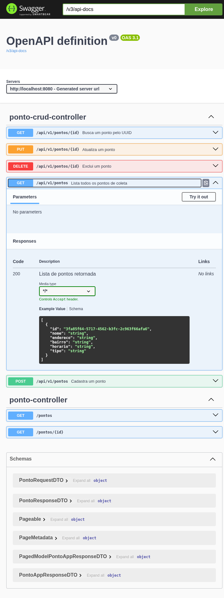
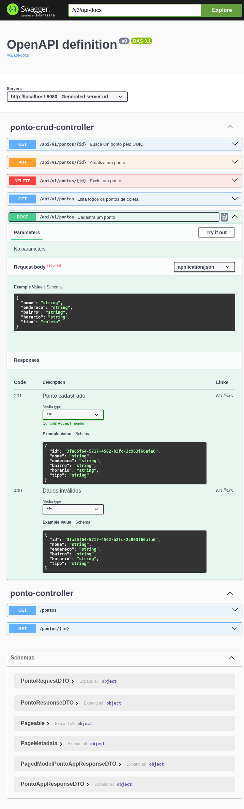
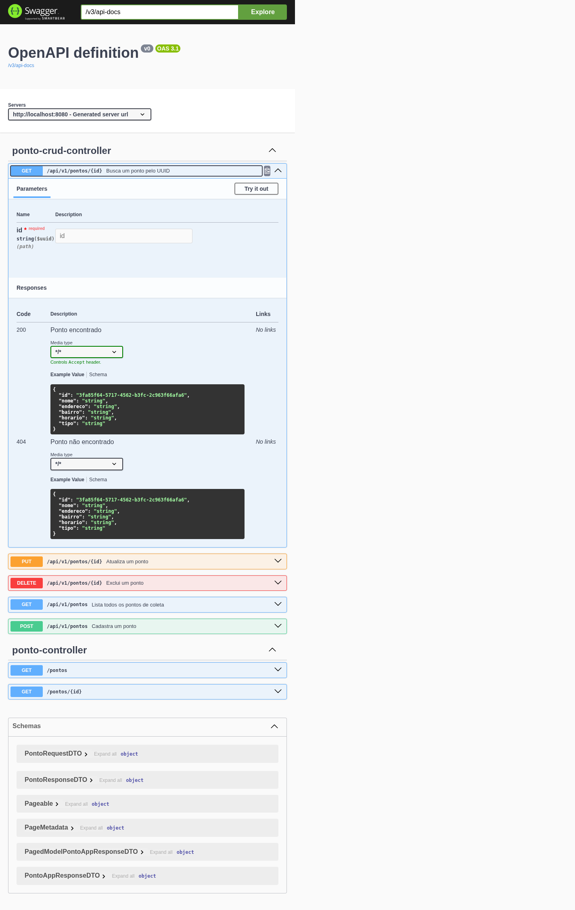
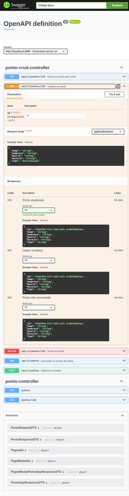
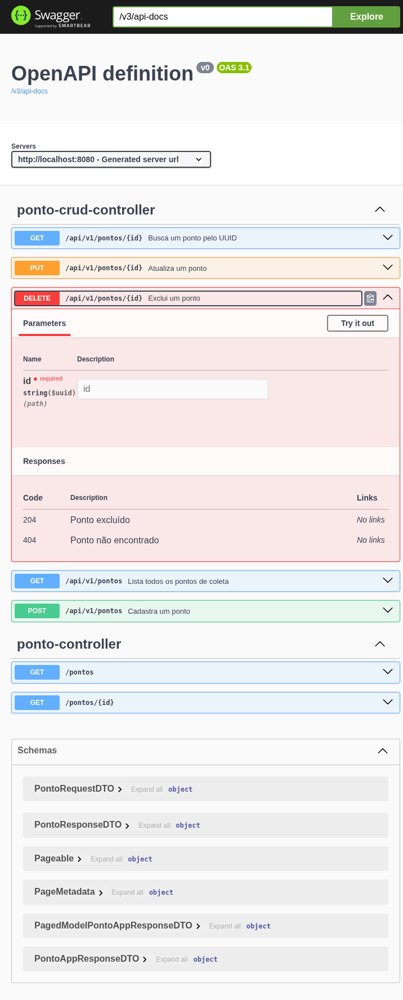
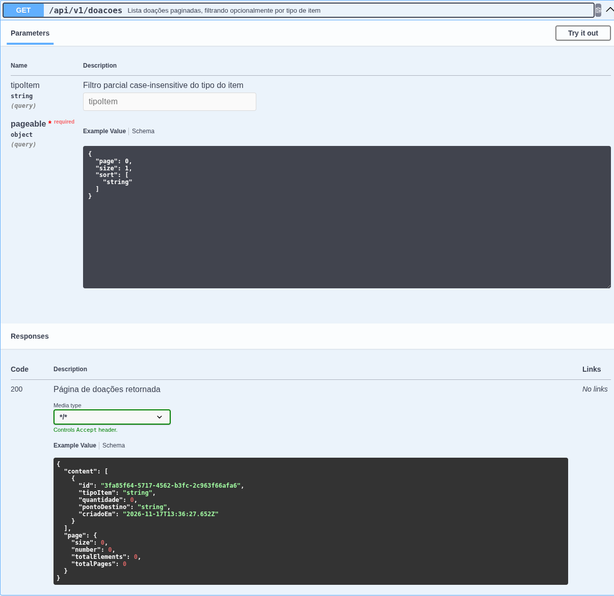
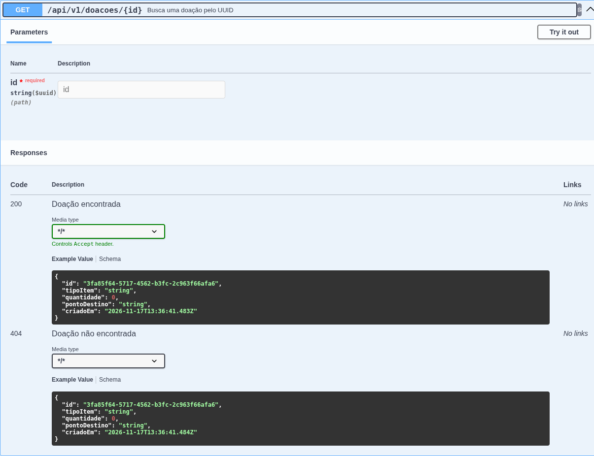
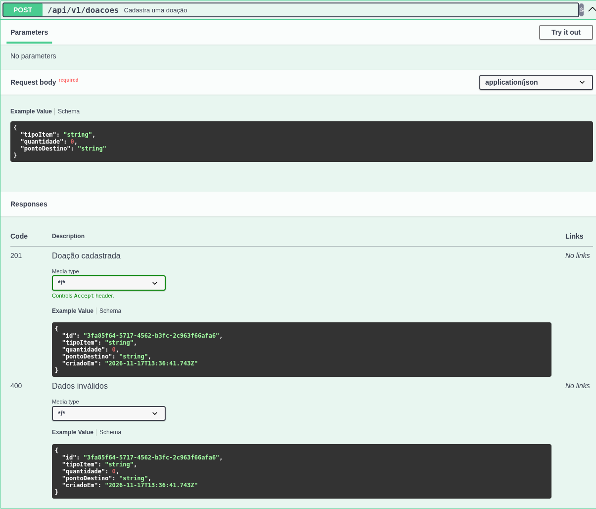
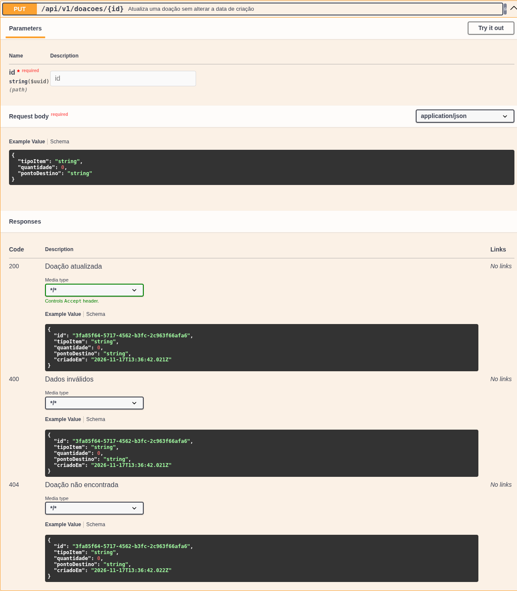
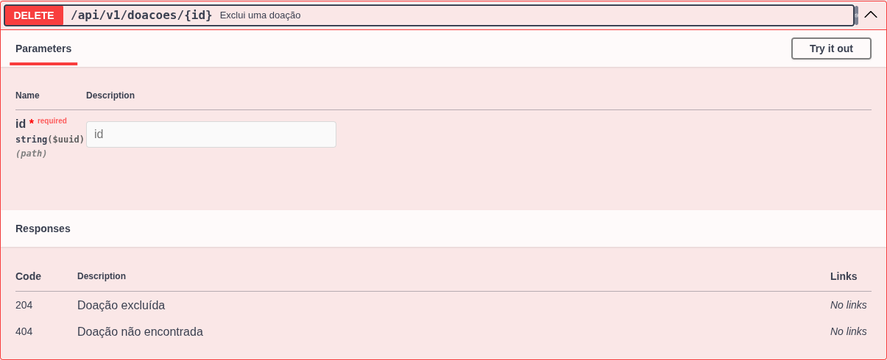

# Instituto Mão Amiga

Aplicativo em React Native, Expo e TypeScript para consultar pontos de coleta e registrar doações. A API Spring Boot deste repositório fornece os pontos e oferece endpoints CRUD para doações; no aplicativo, os registros de doação continuam salvos localmente no aparelho.

## Requisitos

- Node.js 20 ou superior e npm
- Java 21
- Maven 3.9 ou superior
- Expo Go ou um emulador, para executar o app em dispositivo

## API

Na raiz do repositório, inicie o servidor:

```bash
cd api
mvn spring-boot:run
```

O servidor fica disponível em `http://localhost:8080`. A primeira inicialização cria o banco H2 em arquivo e insere 25 pontos de exemplo em Goiânia. Reinicializações preservam os dados e não repetem a carga inicial.

### Endpoints disponíveis

| Método | URL | Descrição |
| --- | --- | --- |
| `GET` | `/pontos` | Lista pontos paginados. Aceita `page`, `size`, `sort` e filtro opcional `nome`; padrão de 20 itens, máximo de 50. |
| `GET` | `/pontos/{id}` | Consulta um ponto pelo UUID; responde 404 quando não existe. |
| `GET` | `/api/v1/pontos` | Lista todos os pontos para o CRUD da N2-1. |
| `GET` | `/api/v1/pontos/paginado` | Busca pontos paginados por `nome` e/ou `bairro` (case-insensitive); padrão de 10 itens ordenados por nome. |
| `GET` | `/api/v1/pontos/{id}` | Consulta um ponto pelo UUID; responde 404 quando não existe. |
| `POST` | `/api/v1/pontos` | Cadastra um ponto; responde 201 ou 400 para dados inválidos. |
| `PUT` | `/api/v1/pontos/{id}` | Atualiza um ponto; responde 404 se não existir ou 400 para dados inválidos. |
| `DELETE` | `/api/v1/pontos/{id}` | Exclui um ponto; responde 204 quando concluído. |
| `GET` | `/api/v1/doacoes` | Lista doações paginadas; aceita `tipoItem`, `page` e `size`, ordena por `criadoEm` decrescente. |
| `GET` | `/api/v1/doacoes/{id}` | Consulta uma doação pelo UUID; responde 404 quando não existe. |
| `POST` | `/api/v1/doacoes` | Cadastra uma doação; responde 201 ou 400 para dados inválidos. |
| `PUT` | `/api/v1/doacoes/{id}` | Atualiza uma doação sem alterar a data de criação; responde 404 ou 400. |
| `DELETE` | `/api/v1/doacoes/{id}` | Exclui uma doação; responde 204 ou 404 quando não existe. |

Os endpoints `/api/v1/pontos` recebem `nome`, `endereco`, `bairro`, `horario` e `tipo`; `tipo` deve ser `coleta` ou `distribuição`. O ID é gerado pela API.

Os endpoints `/api/v1/doacoes` recebem `tipoItem`, `quantidade` (inteiro maior que zero) e `pontoDestino`. A API gera o ID e define `criadoEm` ao cadastrar; atualizações preservam essa data. A listagem usa páginas de 10 itens por padrão e aceita filtro parcial case-insensitive por tipo do item, por exemplo:

```text
GET http://localhost:8080/api/v1/doacoes?tipoItem=roupas&page=0&size=10
```

Corpo de exemplo para `POST` e `PUT` de doações:

```json
{
  "tipoItem": "roupas",
  "quantidade": 3,
  "pontoDestino": "Ponto Centro"
}
```

Exemplos de busca paginada (respostas resumidas):

**Sem filtro** — retorna pontos em páginas de 10 itens, ordenados por nome:

```text
GET http://localhost:8080/api/v1/pontos/paginado
```

```json
{
  "content": [{"id": "uuid", "nome": "Ponto Bosque dos Buritis", "endereco": "Setor Oeste, Goiânia - GO", "bairro": "Setor Oeste", "horario": "Segunda a sexta, 8h às 17h", "tipo": "coleta"}],
  "page": {"size": 10, "number": 0, "totalElements": 25, "totalPages": 3}
}
```

**Filtrando por bairro** — filtros de nome e bairro podem ser combinados:

```text
GET http://localhost:8080/api/v1/pontos/paginado?bairro=Setor%20Bueno
```

```json
{
  "content": [{"id": "uuid", "nome": "Ponto Parque Vaca Brava", "endereco": "Setor Bueno, Goiânia - GO", "bairro": "Setor Bueno", "horario": "Segunda a sexta, 9h às 17h", "tipo": "distribuição"}],
  "page": {"size": 10, "number": 0, "totalElements": 2, "totalPages": 1}
}
```

**Solicitando a segunda página** — a numeração começa em zero; `sort` pode ser alterado pela URL (sem `sort`, a ordem padrão é por nome):

```text
GET http://localhost:8080/api/v1/pontos/paginado?page=1
```

```json
{
  "content": [{"id": "uuid", "nome": "Ponto Parque Areião", "endereco": "Setor Pedro Ludovico, Goiânia - GO", "bairro": "Setor Pedro Ludovico", "horario": "Terça e quinta, 8h às 16h", "tipo": "distribuição"}],
  "page": {"size": 10, "number": 1, "totalElements": 25, "totalPages": 3}
}
```

```text
GET http://localhost:8080/pontos
GET http://localhost:8080/pontos?page=0&size=5&sort=nome,asc
GET http://localhost:8080/pontos/00000000-0000-0000-0000-000000000000
GET http://localhost:8080/api/v1/pontos
GET http://localhost:8080/api/v1/pontos/{id}
POST http://localhost:8080/api/v1/pontos
PUT http://localhost:8080/api/v1/pontos/{id}
DELETE http://localhost:8080/api/v1/pontos/{id}
```

Corpo de exemplo para `POST` e `PUT`:

```json
{
  "nome": "Ponto Centro",
  "endereco": "Praça Cívica, Goiânia - GO",
  "bairro": "Setor Central",
  "horario": "Segunda a sexta, 8h às 17h",
  "tipo": "coleta"
}
```

A resposta de `GET /pontos` usa `content` e metadados de paginação em `page`. A documentação interativa de todos os endpoints está em [Swagger UI](http://localhost:8080/swagger-ui/index.html). Para demonstrar uma validação 400, envie `nome` vazio no corpo acima; para demonstrar 404, consulte ou atualize um UUID inexistente, como `00000000-0000-0000-0000-000000000000`. O console H2, destinado ao desenvolvimento local, fica em [H2 Console](http://localhost:8080/h2-console); use JDBC URL `jdbc:h2:file:./data/instituto-mao-amiga`, usuário `sa` e senha vazia.

### Swagger: endpoints do CRUD da N2-1

Capturas da documentação Swagger gerada pela API. As respostas 400 e 404 estão documentadas nas operações que validam o corpo e consultam/atualizam IDs:

**GET `/api/v1/pontos`**



**POST `/api/v1/pontos` — inclui resposta 400**



**GET `/api/v1/pontos/{id}` — inclui resposta 404**



**PUT `/api/v1/pontos/{id}` — inclui respostas 400 e 404**



**DELETE `/api/v1/pontos/{id}`**



### Swagger: endpoints do CRUD de doações

Capturas do Swagger para cada operação. As respostas de validação `400` e de recurso inexistente `404` estão documentadas nas operações correspondentes.

**GET `/api/v1/doacoes` — listagem paginada e filtro**



**GET `/api/v1/doacoes/{id}` — inclui resposta 404**



**POST `/api/v1/doacoes` — inclui resposta 400**



**PUT `/api/v1/doacoes/{id}` — inclui respostas 400 e 404**



**DELETE `/api/v1/doacoes/{id}` — inclui resposta 404**



As coordenadas dos exemplos correspondem a locais mapeados em Goiânia. Fonte cartográfica: OpenStreetMap, consultada pelo geocodificador Photon; © OpenStreetMap contributors.

## Aplicativo

Instale as dependências na raiz do repositório:

```bash
npm install
```

Inicie o Expo:

```bash
npm start
```

Atalhos para cada plataforma:

```bash
npm run android
npm run ios
npm run web
```

O app consulta a API pelo serviço `src/services/api.ts`. A URL padrão é `http://localhost:8080`; confirme que a API está acessível no navegador em `http://localhost:8080/pontos`. Para testar em um celular físico ou emulador Android, configure `EXPO_PUBLIC_API_URL` com o endereço IPv4 do computador na rede Wi-Fi, por exemplo `http://192.168.1.25:8080`, e reinicie o Expo. O celular e o computador devem estar na mesma rede, e a porta 8080 precisa estar acessível pelo firewall. Essa variável também pode ser definida em um arquivo `.env.local` na raiz do projeto.

## Estrutura

```text
.
├── api/                    # API Spring Boot, JPA e H2
├── src/
│   ├── navigation/         # Tipos das rotas
│   ├── screens/            # Telas do aplicativo
│   ├── services/           # Cliente HTTP e persistência das doações
│   └── types/              # Tipos compartilhados da aplicação
├── App.tsx                 # Configuração da navegação
└── package.json
```

## Verificações

```bash
npx tsc --noEmit
cd api
mvn test
```
